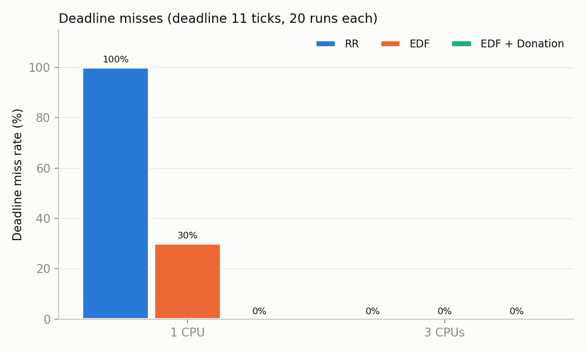
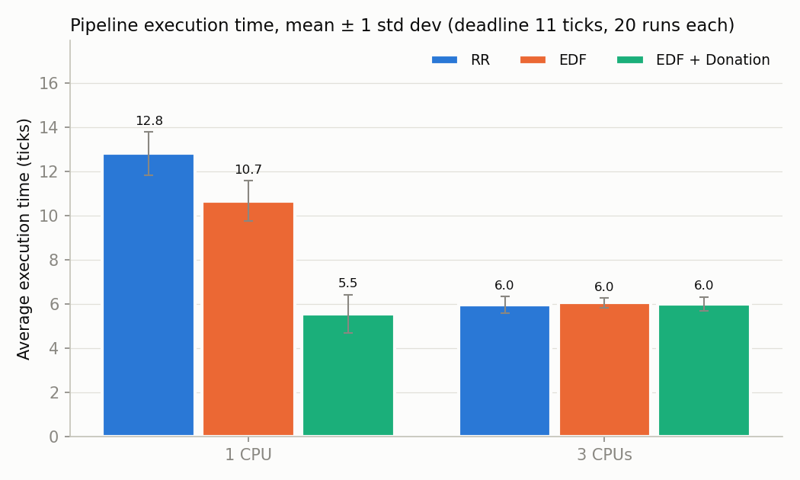

# Scheduler Experiment: RR vs EDF vs EDF + Donation

This compares how often a four-stage pipe pipeline misses its deadline under the
three xv6 schedulers, on 1 and 3 CPUs, with 20 runs per configuration.

## Results

Settings: `pipeline_test 4 5000000 11`, so 4 stages, 5,000,000 loop iterations
of CPU work per stage, and a deadline 11 ticks after the pipeline starts. Times
are in xv6 timer ticks.

| Scheduler | CPUs | Runs | Misses | Miss rate | Average execution time | Std dev | Min | Max |
|---|---|---|---|---|---|---|---|---|
| RR | 1 | 20 | 20 | 100% | 12.80 | 0.98 | 12 | 14 |
| EDF | 1 | 20 | 6 | 30% | 10.65 | 0.91 | 10 | 12 |
| EDF + Donation | 1 | 20 | 0 | **0%** | **5.55** | 0.86 | 5 | 7 |
| RR | 3 | 20 | 0 | 0% | 5.95 | 0.38 | 5 | 7 |
| EDF | 3 | 20 | 0 | 0% | 6.05 | 0.22 | 6 | 7 |
| EDF + Donation | 3 | 20 | 0 | 0% | 6.00 | 0.32 | 5 | 7 |




Raw data for every run is in [`results/runs.csv`](results/runs.csv), and the
console output in [`results/run_log.txt`](results/run_log.txt).

## What the results show

**On 1 CPU, the expected result holds: EDF with donation has the fewest misses.**
The pipeline shares the single CPU with an unrelated CPU hog, which has no deadline.
- **RR** gives the hog an equal share of the CPU, so every pipeline stage runs at
  roughly half speed and every run misses.
- **EDF** gives priority only to the *last* stage, because it's the only process
  with a deadline. That stage spends most of its time blocked waiting on the
  pipe, and the upstream stages have no deadline, so they still compete equally
  with the hog. EDF helps a little: 30% misses and 17% faster than RR.
- **EDF + Donation** passes the last stage's deadline back along the pipeline:
  stage 4 → 3 → 2 → 1, through each blocked pipe read. Every stage then outranks
  the hog, the pipeline finishes in less than half the RR time, and it never
  misses.

**On 3 CPUs, the scheduler makes no difference, and that is expected.** The
pipeline is sequential: only one stage is doing work at any moment. The hog takes
one CPU, so the working stage always has a CPU to itself. With no competition for
a CPU there is nothing for the scheduler to decide, and all three take about 6
ticks with no misses. Donation helps only when CPUs are oversubscribed.

**The ordering does not depend on the chosen deadline.** These miss rates are
recomputed from the same 20 runs for other deadlines. Only the last stage has a
deadline, and its exact value doesn't change any scheduling decision; it only
decides which runs count as misses.

| Deadline (ticks) | 6 | 7 | 8 | 10 | **11** | 12 | 13 | 14 |
|---|---|---|---|---|---|---|---|---|
| RR, 1 CPU | 100% | 100% | 100% | 100% | **100%** | 40% | 40% | 0% |
| EDF, 1 CPU | 100% | 100% | 100% | 35% | **30%** | 0% | 0% | 0% |
| EDF + Donation, 1 CPU | 25% | 0% | 0% | 0% | **0%** | 0% | 0% | 0% |
| Any scheduler, 3 CPUs | 5% | 0% | 0% | 0% | **0%** | 0% | 0% | 0% |

We chose 11 ticks because it lies between RR's fastest run (12) and EDF's
slowest (12 misses, 11 passes), so it separates all three schedulers. A tighter
deadline such as 8 only shows "donation passes, everything else fails".

## Method

`run_experiment.py` automates the whole experiment:

1. For each CPU count and each `SCHED_MODE`, it runs `make clean`, then
   `make SCHED_MODE=<mode>`.
2. It boots one disposable QEMU guest (`-snapshot`, `-smp <CPUS>`) and checks
   from the boot log that xv6 really started that many CPUs (see below).
3. It runs `pipeline_test` 20 times in that guest, one after another. Each run
   waits for the previous one, CPU hog included, to finish.
4. It parses each run's `[METRICS]` line. A run with no `[METRICS]` line stops
   the experiment with an error, so no run is ever dropped silently.
5. It writes `runs.csv`, `summary.md` and both graphs.

It reuses the agent's QEMU bridge (`agent/qemu_bridge.py`) to talk to the guest.

```bash
cd bench
python3 run_experiment.py --deadline 11                   # full experiment (a few minutes)
python3 run_experiment.py --deadline 1000 --runs 5        # just measure execution times
python3 run_experiment.py --deadline 11 --cpus 1 --modes 2  # a single configuration
python3 run_experiment.py --from-csv results/runs.csv     # redraw table and graphs only
```

Needs `matplotlib` for the graphs (`pip install matplotlib`).

## Important: getting more than one CPU in QEMU

On recent QEMU versions, **xv6 silently runs on one CPU whatever `CPUS=` says.**
On QEMU 8.2 with the default machine type, `make qemu CPUS=3` boots with only
`cpu0: starting 0`. A debug print showed xv6 finding `ncpu=1`: the BIOS's
legacy MP table, the only CPU list xv6 reads, contains just one processor. The
same happens with unmodified xv6, so it isn't caused by this project's changes.

This depends on QEMU's machine type:

| Machine type | CPUs xv6 sees with `-smp 3` |
|---|---|
| `pc-i440fx-6.2` and newer (the default) | 1 |
| `pc-i440fx-6.1` and older | 3 |

This is fixed in two places:
- **The Makefile** adds `-machine pc-i440fx-6.1` automatically whenever the
  installed QEMU has that machine type. On older QEMUs, whose default already
  works, it adds nothing. So `make qemu-nox SCHED_MODE=2 CPUS=3` now boots 3
  CPUs; check for `cpu1: starting 1` and `cpu2: starting 2` in the boot messages.
- **The harness** boots with the same machine type and refuses to run if fewer
  CPUs start than requested.

## Caveats

- Ticks come from xv6's timer interrupt under QEMU emulation. Absolute times
  depend on the host machine and its load; the comparison between schedulers in
  the same experiment is what matters.
- The hog does 10× the work of a stage and has no deadline. A different
  background load (several hogs, or hogs with deadlines) could change the 3-CPU
  result.
- These numbers come from a single 20-run experiment on one machine.
